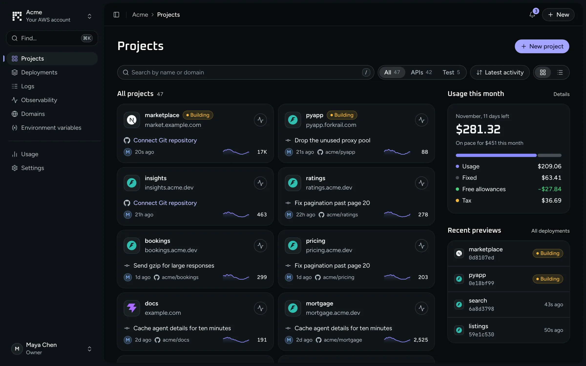
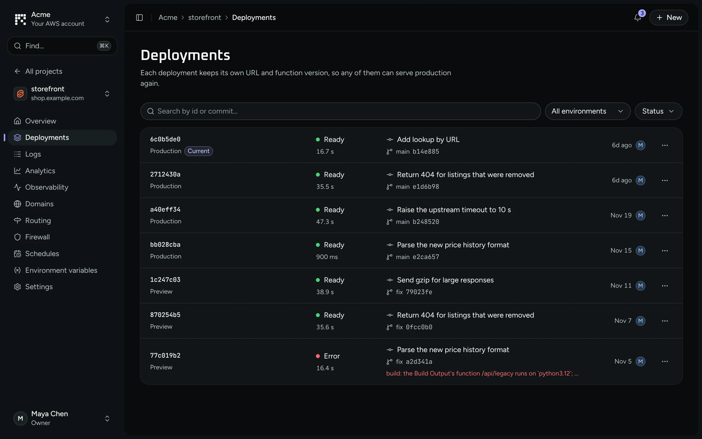
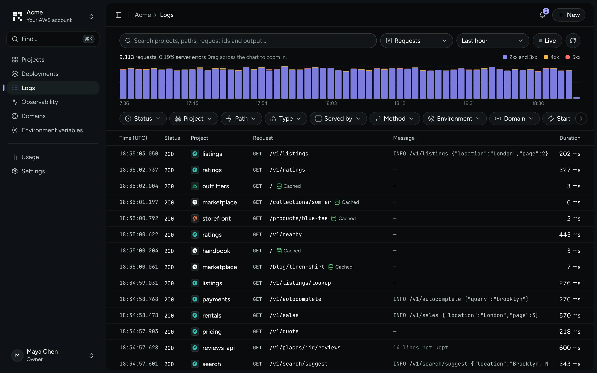
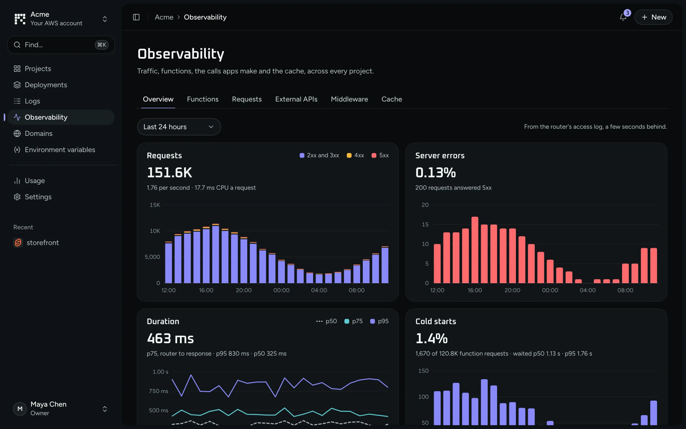
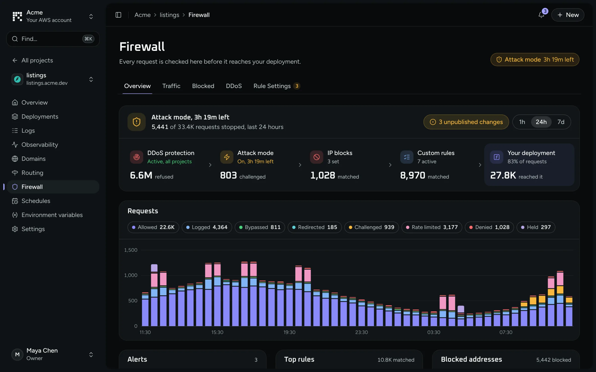
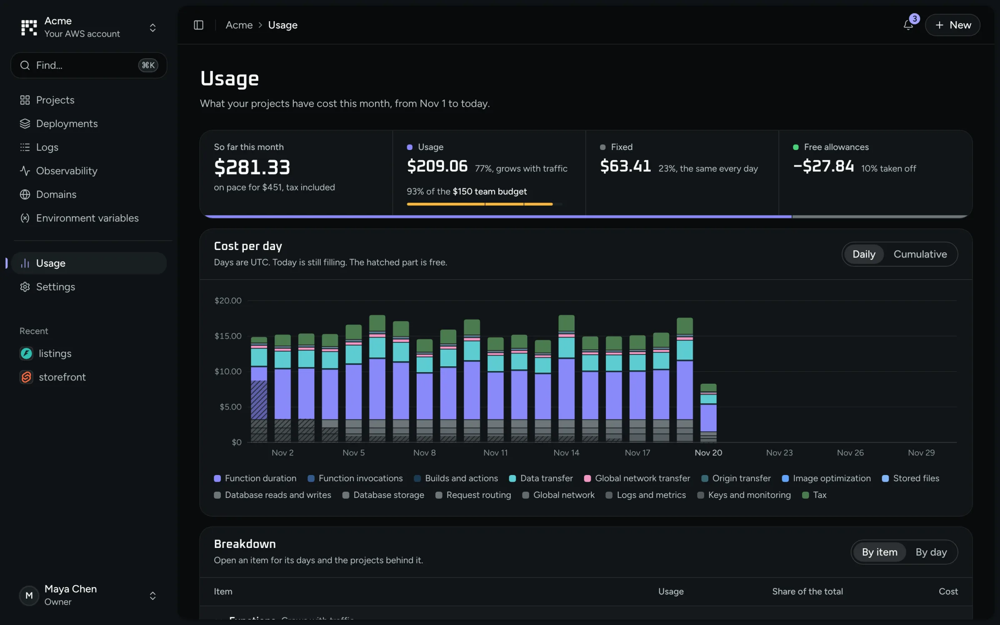
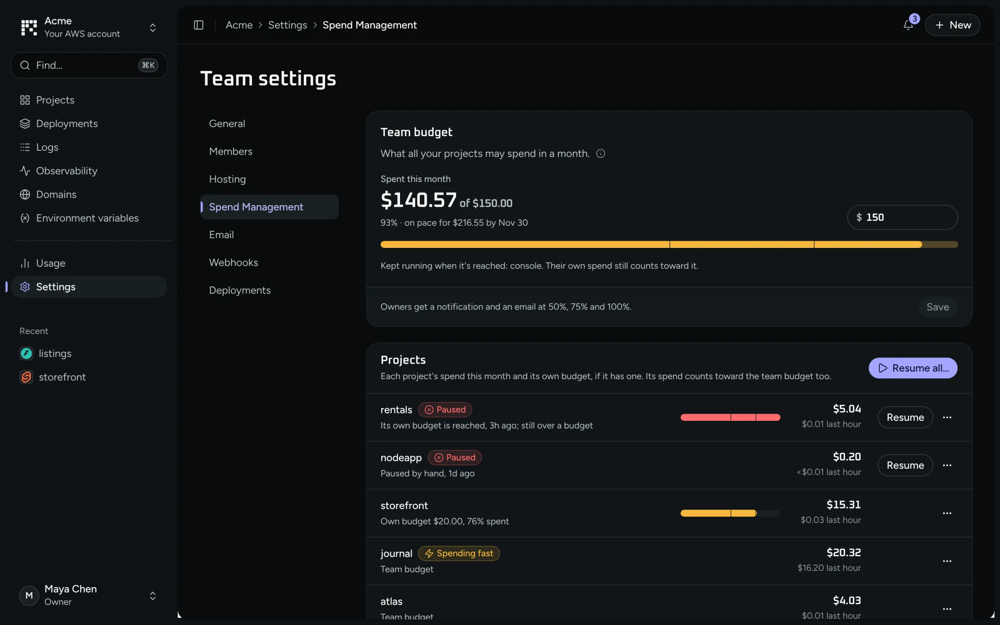
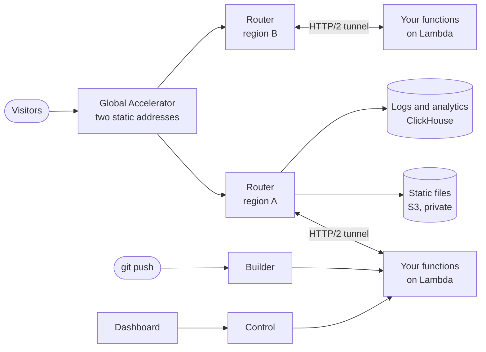

<p align="center">
  <a href="https://forkrail.com">
    <picture>
      <source media="(prefers-color-scheme: dark)" srcset="docs/images/logo-white.svg">
      
    </picture>
  </a>
</p>

<h1 align="center">forkrail</h1>

<p align="center">
  The open-source Vercel and Netlify alternative that runs in your own AWS account.<br>
  Push to deploy, a preview for every branch, rollbacks in seconds, request logs, a firewall and hard spend limits.
</p>

<p align="center">
  <a href="https://github.com/soorower/forkrail-cli/releases/latest"></a>
  <a href="LICENSE"></a>
  
  
  <a href="https://github.com/soorower/forkrail-cli/stargazers"></a>
</p>

<p align="center">
  <a href="https://forkrail.com"><b>Website</b></a>
  &nbsp;·&nbsp;
  <a href="https://forkrail.com/docs"><b>Docs</b></a>
  &nbsp;·&nbsp;
  <a href="#quickstart"><b>Quickstart</b></a>
  &nbsp;·&nbsp;
  <a href="https://forkrail.com/download/mac"><b>Download for Mac</b></a>
  &nbsp;·&nbsp;
  <a href="https://github.com/soorower/forkrail-dashboard"><b>Dashboard source</b></a>
</p>

<br>

<p align="center">
  
</p>

## Why forkrail

Hosting platforms made deploying a web app a `git push`. forkrail gives you that same workflow on infrastructure you own. One command installs it into your AWS account, and from then on it works the way you'd expect: connect a GitHub repository, push, open the preview link, promote it to production, roll back if something looks wrong.

Your functions, files, logs and data stay in your account. You pay AWS's own prices with nothing added, and there are no limits on projects, deployments or teammates. Projects that already run on Vercel move over as they are: forkrail reads `vercel.json` and the framework's own Vercel output.

It's built for production from the start: routers in every region you choose with automatic failover, instant rollbacks, a firewall in front of every project, and spend limits that pause a project within seconds instead of sending you a surprise bill.

## Features

| | |
|---|---|
| **Git deploys** | Every push builds in your own account. Every branch gets its own preview URL, posted as a comment on the pull request. |
| **Instant rollbacks** | Every deployment is kept. Promote any of them, or roll production back, in about five seconds. |
| **The frameworks you use** | SvelteKit, Astro, Nuxt, TanStack Start, React Router, Remix, Vite and static sites. FastAPI, Django, Flask, Express, Hono, Go and Rust APIs. Next.js in beta. |
| **Concurrent compute** | One function instance serves many requests at once, so ten requests in flight are billed as one function, not ten. |
| **Domains** | Add a domain and its certificate is issued and renewed for you. Redirects, wildcards and per-branch domains. |
| **Logs** | Every request with everything your app printed for it. Search, filter and follow it live. |
| **Observability** | Errors, durations and cold starts per route, the outside APIs your apps call, and how the cache is doing. |
| **Web Analytics** | Cookieless page views and custom events. Apps that already use `@vercel/analytics` need no change. |
| **Firewall** | Custom rules, rate limits, bot challenges, IP blocks and an attack mode. Vercel firewall rules import as they are. |
| **Spend limits** | One monthly budget for the team and one per project. Owners hear at 50%, 75% and 100%, and a project at its limit pauses until you resume it. |
| **Everything else** | Cron jobs from `vercel.json`, encrypted environment variables per environment and branch, password-protected previews, and GitHub sign-in for your team. |

## Quickstart

### 1. Install the CLI

```bash
curl -fsSL https://forkrail.com/install | sh
```

On Windows, in PowerShell:

```powershell
irm https://forkrail.com/install.ps1 | iex
```

On a Mac you can [download the app](https://forkrail.com/download/mac) instead. It runs the same installer in a window of its own.

### 2. Set forkrail up in your AWS account

```bash
forkrail install
```

You need:

- an AWS account, signed in as an administrator (the installer opens AWS's sign-in page for you);
- a domain whose DNS is on Cloudflare (the free plan is enough);
- a GitHub account.

The installer asks everything up front, checks the account before it changes anything, then sets everything up in about 15 minutes. If a step fails it says why, and running it again carries on from that step. [docs/install.md](docs/install.md) has every detail.

### 3. Deploy

Open your dashboard at `https://dashboard.<your-domain>`, click **New project** and pick a repository. From then on every push deploys.

Or deploy from a terminal:

```bash
forkrail login https://dashboard.example.com   # once: sign in with GitHub

cd my-app
forkrail deploy             # a preview:  https://my-app-1a2b3c4d.example.com
forkrail deploy --prod      # production: https://my-app.example.com
forkrail rollback my-app    # back to the previous production deployment
```

[docs/deploying.md](docs/deploying.md) covers domains, environment variables, logs, cron jobs, the firewall and spend limits.

## Screenshots

<table>
  <tr>
    <td width="50%"><p align="center"><sub>Deployments, previews and rollbacks</sub></p></td>
    <td width="50%"><p align="center"><sub>Request logs, live</sub></p></td>
  </tr>
  <tr>
    <td width="50%"><p align="center"><sub>Observability</sub></p></td>
    <td width="50%"><p align="center"><sub>Firewall and attack mode</sub></p></td>
  </tr>
  <tr>
    <td width="50%"><p align="center"><sub>Usage, item by item</sub></p></td>
    <td width="50%"><p align="center"><sub>Spend limits</sub></p></td>
  </tr>
</table>

## How it works



- **Routers** are a single Rust program on small Graviton instances, one or more per region, behind AWS Global Accelerator. They terminate TLS, issue certificates, apply each project's routing rules, cache responses, run the firewall and write the request logs.
- **Functions** are your app, packaged as AWS Lambda functions. Each deployment is its own Lambda version, so rollbacks are instant and idle deployments cost nothing. A worker connects back to its router over HTTP/2 and takes requests over that link, which is how one worker serves many requests at once.
- **Builds** run in a builder function in your account, with the same Linux, Node and Python your functions run on.
- **The dashboard** is itself a forkrail project. Changes it makes (promote, roll back, settings) go through a control function that checks who asked.
- **Logs and analytics** go to ClickHouse on one small instance, and are exported to S3 every 10 minutes.

## What it costs

The software is free and open source. In your AWS account, the parts that are always on (the routers, the database and the logs) start at roughly $130 a month, depending on how many regions you run. Everything else is usage at AWS's own prices, and the dashboard shows it item by item. Spend limits keep it within the budget you set.

## What's in this repository

This is all of forkrail except the dashboard, which is [soorower/forkrail-dashboard](https://github.com/soorower/forkrail-dashboard).

| Folder | What it is |
|---|---|
| `crates/cli` | The `forkrail` command, and the library the control function and the builder share with it: installing, building, deploying, domains, projects. The CloudFormation templates and runtime files it installs are built into it. |
| `crates/router` | The routers: TLS and certificates, routing, the cache, the firewall, request logs, and scheduling requests onto functions. |
| `crates/runtime` | What runs in each function: it connects to a router and serves your Node.js, Next.js or Python app. |
| `crates/control` | The control function, which makes the changes the dashboard asks for (promote, roll back, redeploy, settings) with the CLI's code. |
| `crates/builder` | The builder function, which builds one deployment per run. |
| `crates/guard` | Spend protection's second check: pauses a project whose budget AWS's own numbers show is used up. |
| `crates/common` | Types and helpers the others share. |
| `deploy/install` | The CloudFormation templates `forkrail install` applies, and the routers' boot scripts. |
| `deploy/aws` | Scripts for building a release and running an install by hand. |
| `deploy/release` | Publishing releases, and the install scripts (`install.sh`, `install.ps1`). |
| `deploy/macos` | The Mac app. |
| `packages/analytics` | `@forkrail/analytics`, Web Analytics for apps on forkrail. |
| `test-apps` | Small apps in each supported framework and language, used to test deploys. |
| `tools` | Checks that run against a router: tenant isolation, routing compared with Vercel, and a memory-size tuner for functions. |
| `docs` | Installing ([install.md](docs/install.md)) and deploying ([deploying.md](docs/deploying.md)). |

## Build from source

With a current stable Rust:

```bash
cargo build --release -p forkrail-cli    # target/release/forkrail
cargo test --workspace
```

A CLI built this way installs the published release of its own version (the one in `crates/cli/Cargo.toml`) and checks it against the SHA-256 published beside it. To install your own changes to the routers, functions or dashboard, make a release folder with `deploy/aws/bundle.sh DIR` and run `forkrail install --release DIR`. The script's header lists what it needs.

## Contributing

Issues and pull requests are welcome. For anything bigger than a fix, please open an issue first so we can agree on the approach before you write the code.

- Run `cargo test --workspace` before you send a pull request.
- The code isn't formatted with rustfmt. Match the style of the file you're editing, and please don't reformat whole files.
- Keep each pull request to one change, and say in its description how you tested it.

## Security

Please report security problems privately, not in a public issue: see [SECURITY.md](SECURITY.md).

## Licence

forkrail is open source under the [Apache License 2.0](LICENSE). [NOTICE](NOTICE) and [THIRD-PARTY-NOTICES.txt](THIRD-PARTY-NOTICES.txt) list the open-source code it's built with and their licences. The forkrail name and logo aren't covered by the licence.
